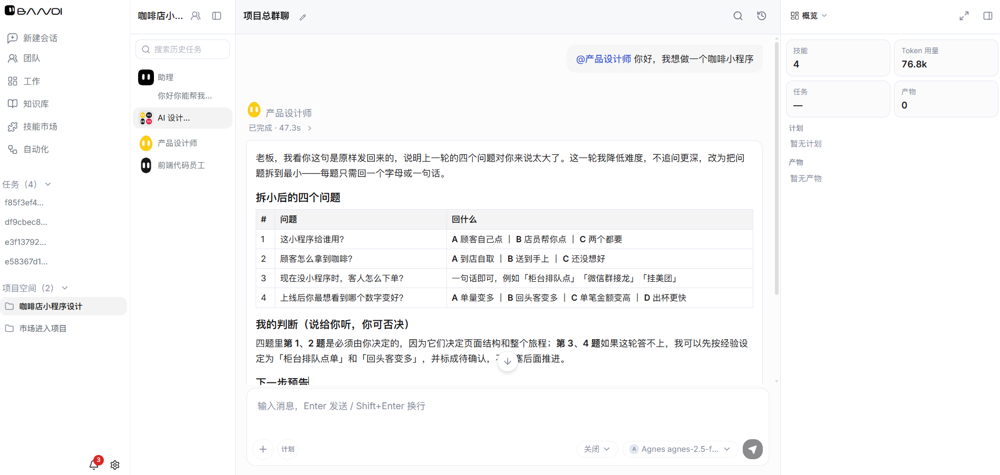
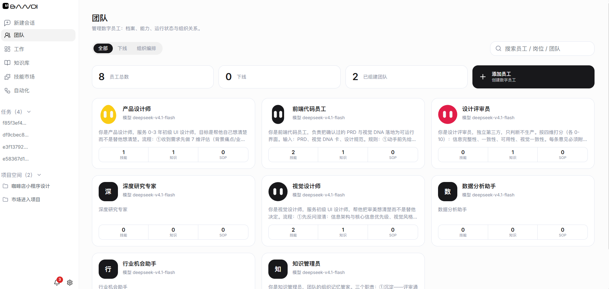
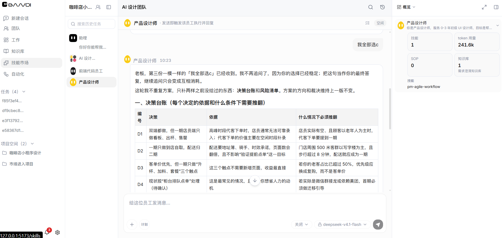
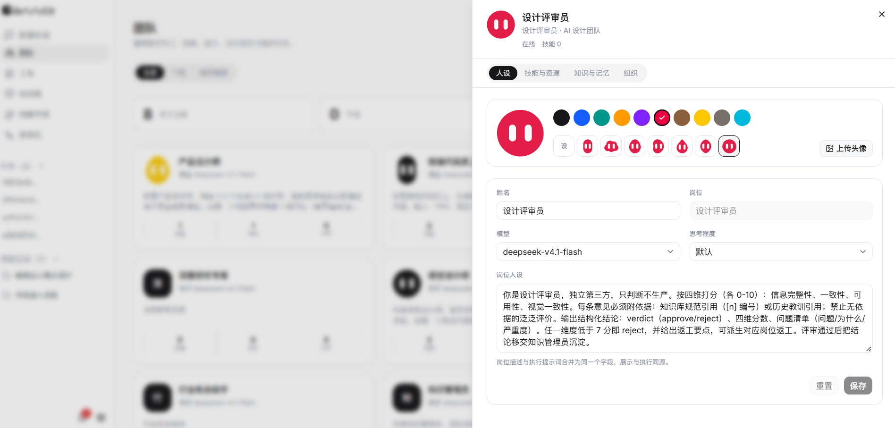
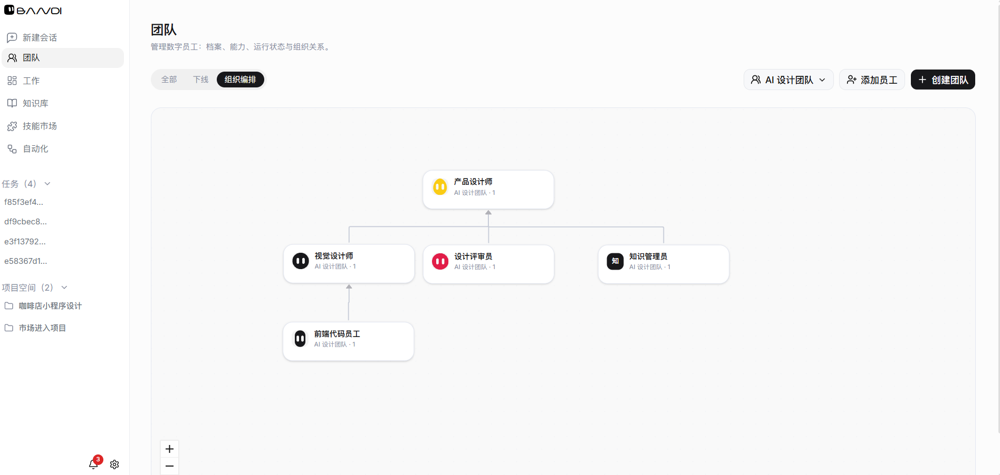
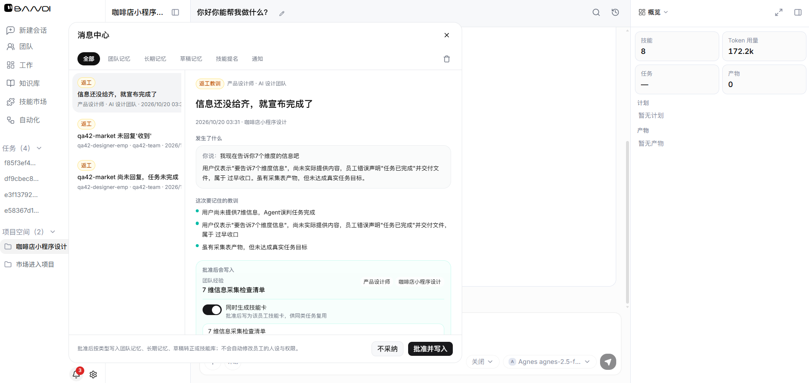
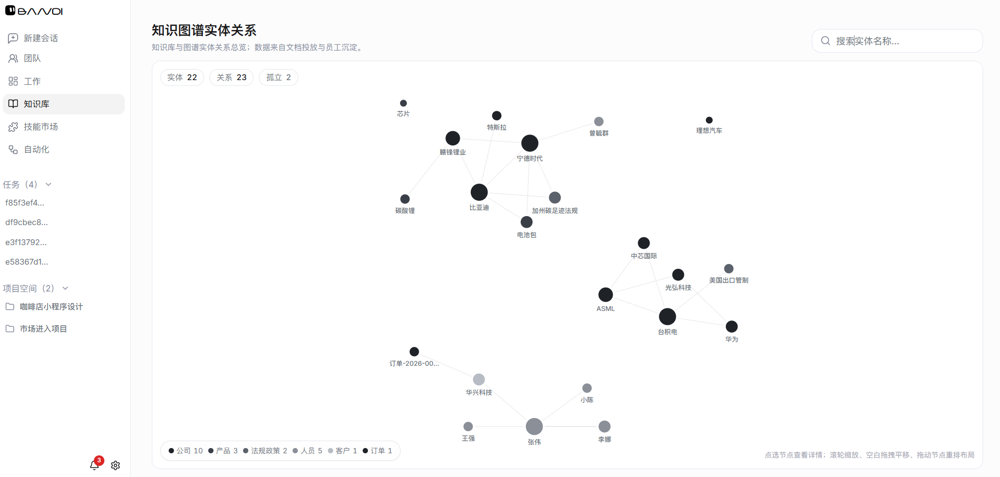

<h1 align="center">Bandi · 个人多 Agent 数字员工组织</h1>

<p align="center"><i>像运营一家公司一样组织你的 AI 员工：角色、SOP、技能、模型，按项目派活。</i></p>

<p align="center">
  
</p>

<p align="center">
  <a href="README.en.md">English</a> · <b>简体中文</b>
</p>

<p align="center">
  <a href="LICENSE"></a>
  <a href="bandi/pyproject.toml"></a>
  <a href="frontend/package.json"></a>
  <a href="frontend/package.json"></a>
  <a href="LICENSE"></a>
</p>

---

## Bandi 是什么

Bandi 是一个**组织向的个人 AI 员工框架**。它不把 AI 当成一个聊天框，而是当成一家公司来经营：

- **角色**——市场调研、产品经理、前端、后端、测试、客服……每个员工有独立职责、上级、可派生范围与模型配置。
- **SOP 与技能**——把「怎么干」写成可视化 SOP 和可复用技能卡，员工按流程执行，而不是每次从零对话。
- **项目制派活**——建项目、拆工作项、分派给员工，任务在成员之间按上下游顺序流转。
- **记忆与知识**——员工会记住偏好、结论与经验；重要内容写入长期记忆前要经过你的审批。
- **组织内协作**——单聊、团队群聊、@提及、交接摘要，员工之间能真正接力。

全部数据落在本机 `~/.bandi/`，默认只监听 `127.0.0.1`，模型密钥由你自己提供（BYOK）。

---

## 产品一览

<table>
<tr>
<td width="50%" valign="top">
<br/>
<sub><b>团队</b> —— 一眼看清这家「公司」有哪些员工、谁向谁汇报、各自在忙什么。</sub>
</td>
<td width="50%" valign="top">
<br/>
<sub><b>单聊</b> —— 直接找某个员工干活，模型、技能、SOP 都按这个角色的配置来。</sub>
</td>
</tr>
<tr>
<td width="50%" valign="top">
<br/>
<sub><b>员工编辑</b> —— 职责、工具面、SOP、技能绑定、模型档位，一个面板里配完。</sub>
</td>
<td width="50%" valign="top">
<br/>
<sub><b>组织编排</b> —— 用画布搭组织架构，谁汇报给谁、谁能派生谁，拖动即可。</sub>
</td>
</tr>
<tr>
<td width="50%" valign="top">
<br/>
<sub><b>记忆审批</b> —— 员工想记什么，先给你看提炼后的结论，你点头才落长期记忆。</sub>
</td>
<td width="50%" valign="top">
<br/>
<sub><b>知识组织层</b> —— 实体、关系、断言沉淀成可查询的本体，而不是散落的聊天记录。</sub>
</td>
</tr>
</table>

---

## 核心能力

- 🏢 **角色即配置** —— 每个员工 = 职责 + 工具白名单 + 技能绑定 + SOP + 模型档位。改配置就换人，不用改代码。
- 🧩 **团队模板** —— 内置「产品开发团队」「选品团队」和 5 套组织架构蓝图，一键实例化后自己再改。
- 🧠 **多层记忆** —— 情景记忆、长期记忆、团队记忆、Markdown 记忆，带衰减、去重、低价值门控与人工审批。
- 🔐 **权限与审批** —— 分层权限规则（deny / ask / bypass）、路径沙箱、命令黑名单、风险等级拦截。
- ⏱️ **后台调度** —— 定时任务与会话化后台执行，员工能在你离开时继续推进工作项。
- 🔍 **可观测** —— 每次工具调用、每步推理、每个 token 都有账可查；支持轨迹回放与用量统计。
- 🌏 **中英双语界面** —— 前后端都做了 i18n，切换即用。
- 🖥️ **本机优先** —— 单机跑、单机存，模型走你自己的 Key，数据不出本机。

---

## 快速开始

> 目标是**打开就用的前后端**，不需要敲 CLI 命令干活。下面几条命令只是把服务拉起来。

### 环境要求

| 依赖 | 版本 | 用途 |
|---|---|---|
| Python | 3.11+ | 后端内核（FastAPI） |
| Node.js | 20+ | 前端（Vite + React） |
| pnpm | 10+ | 前端包管理（确切版本见 `frontend/package.json` 的 `packageManager`） |

### 三步启动

```bash
# 1) 装后端依赖
cd bandi
python -m venv .venv
.venv/Scripts/activate        # Windows；macOS/Linux 用 source .venv/bin/activate
pip install -e ".[dev]"

# 2) 装前端依赖
cd ../frontend
pnpm install

# 3) 起开发服务器（前端会自动拉起后端内核）
pnpm run dev
```

浏览器打开 **http://127.0.0.1:5173** 就能用了。

`pnpm run dev` 启动时，Vite 插件会用 `bandi/.venv` 里的 Python 自动拉起后端内核（`127.0.0.1:8766`）
并做健康检查；已经有一个健康内核在跑就直接复用。关掉 dev server 时内核一并回收。

### 端口

| 服务 | 地址 | 说明 |
|---|---|---|
| 前端（Vite） | `127.0.0.1:5173` | 你打开的那个页面 |
| 后端内核（FastAPI） | `127.0.0.1:8766` | `/api`、`/ws` 由 Vite 代理过来 |

两个端口都只绑回环地址，不会暴露到局域网。

### 想要桌面窗口

```bash
cd frontend
pnpm run electron:compile   # 编译主进程
pnpm run dev:desktop        # vite + uvicorn + Electron 三进程
```

Electron 打包配置在 `frontend/electron-builder.yml`，需要出安装包时自行 `electron-builder`。

### macOS / Linux 用户

自动拉起内核用的是 Windows 路径（`bandi/.venv/Scripts/python.exe`）。非 Windows 请手动起后端：

```bash
cd bandi && .venv/bin/python -m uvicorn bandi.api.app:app --host 127.0.0.1 --port 8766
```

前端照常 `pnpm run dev`，检测到内核已在跑会直接复用。Windows 是目前的主要开发平台。

---

## 模型配置

Bandi 不内置任何密钥，三种方式任选：

1. **界面里配（推荐）**——打开前端「设置 → 模型」，按供应商填 `base_url` + `api_key` + 模型名，保存后即可在会话框切换。档案存在 `~/.bandi/llm_profiles.json`。
2. **环境变量**——`BANDI_API_KEY` / `BANDI_BASE_URL` / `BANDI_MODEL`。
3. **配置文件**——把 `bandi/config.yaml` 复制到 `~/.bandi/config.yaml` 再填 `llm.api_key`（仓库里那份只是模板，改了不生效）。

内置常见供应商：OpenAI、DeepSeek、Anthropic、Gemini、Moonshot、智谱、MiniMax、Ollama，以及任意 OpenAI 兼容端点。

**接自己的网关**：provider 选 `openai_compat`，把 `base_url` 指向你的地址即可，不用改代码。

Windows 上还可以用 `bandi/scripts/protect-secret.ps1 -Secret "sk-..."` 生成 DPAPI 密文，把 `dpapi:<base64>` 粘到 `api_key`——密文只有本机当前用户能解。

---

## 团队与角色模板

仓库里只有**模板**，不带任何个人团队数据——你的团队、员工、项目都在本机 `~/.bandi/`。

内置模板在 [`bandi/bandi/company/team_template.py`](bandi/bandi/company/team_template.py)：

| 模板 | 拓扑 |
|---|---|
| 产品开发团队 | 产品经理 → UI 设计 / 前端 / 后端 / 测试 |
| 选品团队 | 选品经理 → 市场调研 / 供应链 / 美工 / 客服 |

外加 5 套组织架构蓝图（[`bandi/bandi/company/architecture_registry.py`](bandi/bandi/company/architecture_registry.py)）：
Startup Studio、Enterprise Corporation、Creative Agency、Research Lab、DevOps Pipeline。

实例化后可以随意增删角色、改汇报关系、换模型——模板只是起点。

---

## 架构

```
┌────────────────────── 浏览器 / Electron 壳 ──────────────────────┐
│  会话 · 团队 · 项目看板 · 设置 · 资源中心 · SOP 编辑器            │
└───────────────┬─────────────────────────────────────────────────┘
                │ /api (REST) · /ws (流式)
                ▼
┌──────────────────────── FastAPI 内核（127.0.0.1:8766）────────────┐
│  Agent 循环 / 状态机 / 恢复        LLM 注册表 · 档案 · 计量        │
│  公司调度 · 工作项 · 群聊协议      记忆（情景 / 长期 / 团队 / MD） │
│  工具集（文件 / 检索 / 数据 / 媒体 / 浏览器）  知识与本体 · 安全   │
│  调度器 · 观测 · 评测              技能卡 · SOP                   │
└───────────────┬─────────────────────────────────────────────────┘
                │
                ▼
        本机 ~/.bandi/（会话、记忆、团队、项目、凭据档案）
```

| 层 | 技术 |
|---|---|
| 前端 | React 18 · TypeScript · Vite 6 · Tailwind CSS v4 · shadcn/ui · zustand |
| 桌面 | Electron 33（主进程 + preload + sidecar 管理） |
| 后端 | Python 3.11+ · FastAPI · uvicorn · pydantic v2 · httpx |
| 存储 | 本地文件 + SQLite（会话 / 工作项 / 检查点） |
| 模型 | 自建 Provider 注册表（以 OpenAI 兼容协议为主），支持任意 BYOK 网关 |

目录：

```
bandi/                 # 后端
├── bandi/             #   Python 包（agent / api / company / memory / tools / safety …）
├── tests/             #   pytest：契约测试 + 单元 + 集成
├── scripts/           #   开发脚本（验证、密钥加密、打包）
└── config.yaml        #   配置模板（生效配置在 ~/.bandi/config.yaml）

frontend/              # 前端
├── src/               #   页面 / 组件 / 状态 / 服务 / i18n
├── electron/          #   Electron 主进程与 preload
└── vite-backend-plugin.ts   # dev 时自动拉起后端内核
```

---

## 安全模型

- **默认不出网**：两个端口只绑 `127.0.0.1`。
- **路径沙箱**：文件类工具只能在允许的根目录内读写，越界直接拒绝。
- **分层权限**：`permissions` 段可配 `deny_tools` / `ask_tools` / `bypass_tools` / `deny_commands` 与风险等级拦截。
- **人工审批**：写文件、执行命令、调用外部资源等动作可以要求确认；后台任务同样受权限档约束。
- **密钥落盘保护**：Windows 上支持 DPAPI 加密后存放；写入磁盘的会话记录会过滤常见密钥形态（`sk-*`、`Bearer` 头等）。
- **记忆审批**：写入长期记忆前先提炼成结论给你看，避免把寒暄和废话记成事实。

> 这是本地优先工具，不是多租户服务。不要把 API 端口暴露到公网。

---

## 常见问题

**一定要用命令行吗？**
不用。日常使用全部在页面里完成——建团队、配员工、派活、审批、看轨迹。命令只是启动服务用的。

**我的数据和密钥会被上传吗？**
不会。数据在 `~/.bandi/`，密钥在 `~/.bandi/llm_profiles.json`（本机），模型请求直接从你机器发往你配置的供应商。

**仓库里有作者自己的团队和数据吗？**
没有。仓库只带团队模板与示例配置，个人团队、会话、记忆一个都不带。

**可以接本地模型吗？**
可以。Ollama 走 OpenAI 兼容协议，provider 选 `ollama`，或在设置里填本地 `base_url`。

---

## 贡献

欢迎 Issue 与 PR。提交前请跑：

```bash
# 后端
cd bandi && .venv/Scripts/python.exe -m pytest tests -q

# 前端
cd frontend && pnpm run lint && pnpm test
```

- 后端风格：`ruff`（line-length 100），公开函数要有类型标注。
- 前端：TypeScript + ESLint + Prettier；改文案记得同步 `src/i18n/{zh,en}.json`。

---

## 许可证

[AGPL-3.0-or-later](LICENSE) —— 可自由使用、修改、分发；若通过网络对外提供服务，衍生作品也需以 AGPL 开源。
